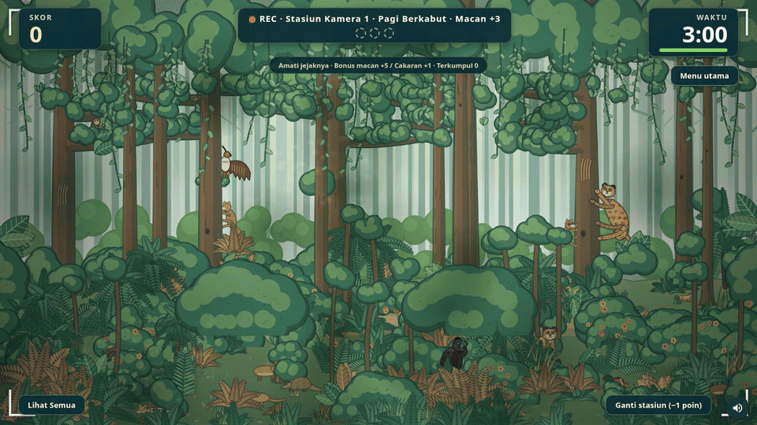

# Jejak Si Macan Tutul · V7 Kompetisi Expo

Game edukasi Bakti BCA: cari macan tutul jawa di hutan Bromo Tengger Semeru, kenali satwa lain, dan pelajari Java Wide Leopard Survey (JWLS).

Versi ini melanjutkan **attachment Macan Tutul V2**, termasuk durasi awal tiga menit, hutan lebat, zoom, pergantian stasiun, dan kartu fakta yang dibaca tanpa mengurangi waktu permainan.



[Demo bonus macan lari dan mengintip](docs/bonus-demo.gif)

[Atlas 12 pose macan utama](docs/pose-macan.png) · [Atlas pose pengecoh](docs/pose-pengecoh.png)

## Menjalankan di booth

1. Salin **`dist/jejak-si-macan-tutul.html`** ke PC booth.
2. Buka dengan Chrome atau Edge. Semua gambar, kode, dan materi permainan sudah berada di dalam file; internet tidak diperlukan untuk bermain.
3. Pilih tombol layar penuh atau tekan F11. Gunakan monitor/touchscreen landscape.
4. Coba satu sesi di perangkat booth sebelum acara. Nonaktifkan sleep dan screen saver melalui pengaturan PC.

Bacaan siaran pers pada menu **Kenali JWLS** membutuhkan internet. Permainan dan kartu edukasi tetap berjalan tanpa koneksi. Penyimpanan skor untuk file lokal bergantung pada pengaturan browser: selalu uji simpan dan cadangan di PC tujuan.

## Ukuran target dan menu panitia

Macan utama diperbesar dengan batas minimum yang tetap berlaku pada level lanjut. Anak macan tetap lebih kecil secara proporsional. Bonus lari dan kepala mengintip juga diperbesar; pengecoh mempertahankan ukuran sebelumnya.

Tombol **Menu utama** di kanan atas layar permainan tetap tersedia ketika kartu edukasi terbuka. Konfirmasi membatalkan sesi tanpa menyimpan skor sementara; batal melanjutkan sesi yang sama. Skor yang sudah tersimpan tidak diubah. **Esc** dapat membuka konfirmasi yang sama. **Ctrl+Shift+A** saat bermain membuka konfirmasi keluar lalu panel PIN admin, sehingga panitia bisa mengubah durasi dan suara sebelum memulai sesi baru.

## Komposisi acak dan hutan rimbun

Setiap stasiun memilih salah satu komposisi, lalu mengacak jumlah, jenis, posisi, pose, dan warna varian satwa. Angka target sudah termasuk anak macan.

| Variasi | Macan utama | Pengecoh |
| --- | --- | --- |
| Jejak langka | 2–3 | 12–16 |
| Satwa beragam | 3–4 | 10–14 |
| Lebih banyak target | 4–6 | 9–13 |

Jumlah macan tidak terus bertambah pada level lanjut. Tantangan berasal dari kamuflase, tutupan hutan, mode pencahayaan, dan pilihan pengecoh. Batas ukuran macan tetap dipertahankan. Hutan diacak dari seed baru pada setiap stasiun dan sesi; kepadatan konfigurasi permainan dijaga pada 0,94–1,00. Seed yang sama mereproduksi susunan hutan dan satwa yang sama; noise inframerah bersifat dekoratif.

Urutan bonus lari, semak dan kepala mengintip, arah gerakan, lokasi, serta jeda kemunculannya juga diacak dalam batas waktu yang ditentukan.

## Pose dan penempatan

Macan utama memiliki **12 pose**: merunduk/mengendap, mengendus tanah, meregangkan tubuh, merawat bulu, meringkuk, mencakar batang, memanjat, berjalan, duduk waspada, berbaring, bersantai di dahan, dan mengintip. Setiap stasiun mengawali pemilihan dengan salah satu pose tanah baru; pose di pohon tidak lagi diwajibkan. Anak macan juga mendapat variasi pose.

Keempat belas jenis pengecoh memiliki **3–5 pose per jenis** (57 variasi total), sesuai perilaku: kijang/kancil berdiri, berjalan, merumput dan waspada; mamalia kecil mengendus atau merunduk; primata berjalan atau meraih dahan; burung mencari makan, menoleh, dan membuka sayap; trenggiling meringkuk dan landak mengembangkan duri.

Stasiun mengacak pola **tersebar, berkelompok, atau campuran**. Jarak berdekatan tetap menjaga area tubuh terpilih dan tidak menumpuk siluet secara berlebihan. Pose memanjat/mencakar dipasang pada batang; pose bertengger/meraih dahan memakai lokasi dahan; pose tanah berbaur dengan pakis dan serasah. Tanaman penutup dan mask klik dihitung dari pose sebenarnya. Kelompok satwa dalam permainan adalah simulasi gabungan rekaman, bukan gambaran bahwa macan dewasa hidup bergerombol.

## Hutan bergerak dan stasiun malam

Sebagian pengecoh memakai animasi: kucing kuwuk dan landak berjalan bolak-balik pada lintasan pendek, monyet bergelantungan dari titik dahan, dan elang terbang sambil mengepakkan sayap pada stasiun pagi. Musang dan bajing juga dapat memanjat batang pohon. Semua termasuk populasi pengecoh yang sama, bukan penambahan target. Warna kuwuk dan musang tetap dekat dengan warna macan, dengan pola dan anatomi pembeda.

Lintasan dibatasi agar tidak menutupi target utama atau cakaran. Tanaman dan objek di depan memotong gambar serta area klik dengan mask yang sama. Pengecoh dapat tertutup sementara selama bergerak; klik pada bagian yang tertutup tidak dihukum. Menekan satwa yang terlihat lalu melepas ketika ia bergerak tetap mencatat satwa yang disentuh; drag/pinch tetap menjadi navigasi. Gerak satwa dan daun berhenti selama jeda/kartu fakta.

Rumpun daun kecil pada pohon bergoyang halus; area goyangnya ditempatkan di luar area satwa dan petunjuk sehingga tidak menciptakan sasaran atau penalti tersembunyi.

| Waktu stasiun | Macan utama | Bonus macan |
| --- | --- | --- |
| Pagi, siang, senja | +3 | +5 |
| Malam (inframerah) | +5 | +7 |

HUD menunjukkan nilai yang berlaku di stasiun tersebut. Pengecoh diam maupun bergerak tetap −2 poin dan −5 detik per klik; cakaran dan skip tetap +1 dan −1. Hasil, CSV dan cadangan memakai poin temuan aktual sehingga sesi campuran siang/malam tetap dapat direkonsiliasi.

## Aturan

- **Target utama: +3 poin, malam +5** untuk tiap macan tutul atau macan kumbang. Temukan semuanya untuk menyelesaikan stasiun.
- **Bonus satwa: +5 poin, malam +7** untuk macan yang berlari melompat, muncul dari semak, atau mengintip dari kiri/kanan. Gerak lari memiliki dua belas frame animasi dan fase tubuh melayang. Bonus tidak masuk indikator target utama, tidak wajib ditemukan, dan tidak memberi penalti jika terlewat.
- Bonus pertama muncul setelah tiga hingga lima detik waktu main aktif. Maksimal tiga kemunculan per stasiun: lari melewati layar selama 3,2 detik, lintasan di antara semak selama 2,4 detik, dan kepala mengintip selama 1,8 detik. Ada jeda enam hingga delapan detik antarkemunculan; urutan ketiga pola diacak. Tanaman menutup tampilan sekaligus area klik; tidak bisa mengeklik bagian tubuh di balik daun. Kartu fakta dan jeda stasiun menghentikan jam bonus.
- **Cakaran pohon: +1 poin** per kelompok bekas cakaran, sekali saja. Ada dua kelompok per stasiun; keduanya bonus opsional yang tidak masuk target utama. Semua cakaran terang yang digambar pada batang merupakan objek interaktif.
- Ada **empat belas jenis pengecoh**: kucing kuwuk, kijang muncak, ayam hutan merah, landak jawa, lutung jawa, elang jawa, binturong, trenggiling peusing, linsang, monyet ekor panjang, musang luwak, garangan jawa, pelanduk kancil, dan bajing kelapa. Setiap stasiun memuat sembilan hingga enam belas pengecoh dan dua hingga enam macan utama, sesuai komposisi acak. Pemilihan memprioritaskan jenis berwarna cokelat keemasan, sambil mempertahankan bentuk dan pola pembeda.
- Setiap klik pada pengecoh, diam maupun bergerak, mengurangi dua poin dan lima detik, termasuk klik ulang pada satwa yang sama. Skor minimum nol; waktu dan jumlah kesalahan tetap dipotong/dicatat ketika skor sudah nol.
- Scroll atau cubit untuk zoom, geser untuk menjelajah, dan pilih **Lihat Semua** untuk kembali ke tampilan penuh. Menggeser dan mencubit tidak dihitung sebagai jawaban.
- **Ganti stasiun (−1 poin)** melewati kamera tanpa mengisi target yang belum ditemukan. Skor berkurang satu, dengan minimum nol. Contoh: dari lima macan, tiga sudah ditemukan = sembilan poin → skip → delapan poin tersisa. Klik berulang pada tombol selama transisi tidak menggandakan penalti.
- Hasil menampilkan jumlah temuan, poin temuan, bonus satwa, cakaran, serta penalti skip dan pengecoh secara terpisah. Skor total = poin temuan + bonus satwa + poin cakaran − penalti skip aktual − penalti pengecoh aktual. Potongan aktual menjaga rekonsiliasi ketika skor sudah nol.

Kepadatan satwa dan pertemuan dalam game merupakan simulasi edukasi, bukan gambaran jumlah satwa di satu lokasi.

## Panel panitia dan data

Ketuk pojok kiri atas beranda lima kali, atau tekan **Ctrl+Shift+A**. PIN awal: **1234**; ganti `adminPin` pada `js/config.js` lalu bangun ulang sebelum acara. PIN ini adalah pengunci antarmuka lokal, bukan autentikasi server.

Panel menyediakan durasi **60 / 90 / 120 / 180 detik**, suara, ekspor CSV, cadangan JSON, pemulihan cadangan, dan penghapusan skor. Durasi bawaan pada perangkat baru adalah **180 detik**. Pengaturan lama yang masih valid dipertahankan.

Skor hanya tersimpan di browser/perangkat tersebut. Untuk pindah PC:

1. Di PC lama, pilih **Simpan cadangan** dan salin berkas JSON bersama HTML game.
2. Di PC baru, buka game, pilih **Muat cadangan**, lalu pilih JSON. Impor menggabungkan skor dan mengabaikan ID yang sudah ada.
3. Ekspor CSV untuk rekap; kolom temuan utama, poin temuan, penalti poin pengecoh, jumlah bonus satwa, poin bonus, cakaran, poin cakaran, jumlah skip, penalti skip, dan versi aturan disertakan.

Skor versi lama tidak dihapus otomatis. Karena V7 memberi nilai lebih tinggi pada stasiun malam, panitia sebaiknya memulai papan kompetisi baru melalui panel setelah menyimpan cadangan. Jangan membandingkan skor dengan aturan berbeda sebagai satu kompetisi.

## Mengembangkan

Tidak ada dependency runtime atau build framework. Ubah `stationMixes` di `js/config.js` untuk mengatur jumlah satwa; `stages` mengatur habitat dan pencahayaan. Untuk versi multi-file:

```sh
python -m http.server 8080
```

Buka `http://localhost:8080`. Service worker menyimpan aset untuk penggunaan offline setelah instalasi cache berhasil. Untuk distribusi satu file:

```sh
node tools/build-single.mjs
```

Pemeriksa konten mencegah digit dalam `js/content.js` agar angka hasil survei internal tidak ikut masuk tanpa sengaja. Metadata tanggal sumber pada panel informasi terpisah dari pemeriksa ini.

Jalankan regresi browser dengan Python Playwright dan Chromium yang sudah terpasang:

```sh
python tools/test-game.py
```

Gunakan `CHROMIUM_PATH` jika executable bukan `/usr/bin/chromium`; gunakan `JSMT_TEST_OUTPUT` untuk mengganti folder hasil QA. Pengujian memulai server sementara dan tidak memakai profil browser pengunjung.

Struktur utama:

- `js/scene.js`: penempatan satwa, lapisan tanaman, mask tubuh yang terlihat.
- `js/motion.js`: pengecoh bergerak, lintasan, mask klik bersama render, dan goyangan daun.
- `js/bonus.js`: lompatan/lari, kemunculan semak, kepala mengintip, waktu aktif dan mask bonus.
- `js/game.js`: skor, penalti, transisi, timer dan efek.
- `js/content.js`: aturan dan kartu edukasi.
- `js/art/`: ilustrasi vektor satwa dan hutan; `animal-poses.js` menambahkan perilaku/pose pengecoh; `assets/forest-hero.webp`: ilustrasi pembuka.
- `docs/EXPO-RELEASE.md`: perubahan, sumber, dan batas verifikasi.

## Sumber edukasi

Laporan yang diberikan panitia berjudul **Kajian Struktur Populasi Macan Tutul Jawa serta Preferensi Satwa Mangsanya di Bentang Alam Bromo Tengger Semeru, Jawa Timur — Laporan Kemajuan Januari 2024–Agustus 2026**. Hanya materi kualitatif dipakai; PDF dan angka survei internal tidak dimasukkan ke repo.

Sumber publik: [siaran pers BCA, 4 Mei 2026](https://www.bca.co.id/id/tentang-bca/media-riset/pressroom/siaran-pers/2026/05/04/03/57/demi-keseimbangan-ekosistem-kolaborasi-bakti-bca-untuk-pelestarian-macan-tutul) [publikasi BBKSDA Jawa Timur tentang JWLS Gunung Wilis, 11 Agustus 2026](https://bbksdajawatimur.id/cari-jejak-macan-tutul-di-gunung-wilis-kamera-ungkap-cerita-lain), dan [Konservasi Alam & Keanekaragaman Hayati BCA](https://www.bca.co.id/id/tentang-bca/sustainability/environment/upaya-pengurangan-emisi-grk-operasional/konservasi-alam-and-keanekaragaman-hayati).

Empat jenis pengecoh terbaru adalah contoh satwa hutan Jawa berdasarkan publikasi Gunung Wilis; bukan klaim bahwa semuanya terdeteksi pada survei Bromo Tengger Semeru dalam lampiran.

Ilustrasi pembuka dibuat dengan bantuan AI; satwa permainan memakai ilustrasi programatis. Tulisan Bakti BCA merupakan teks identitas, bukan aset logo resmi. Gunakan master logo dari tim brand jika diperlukan untuk final produksi acara.
